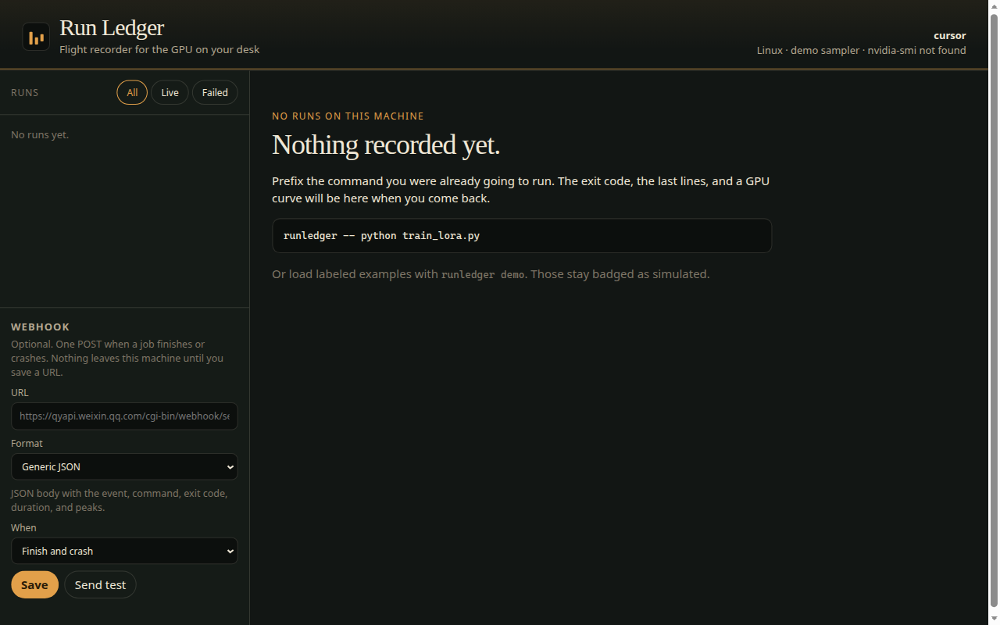
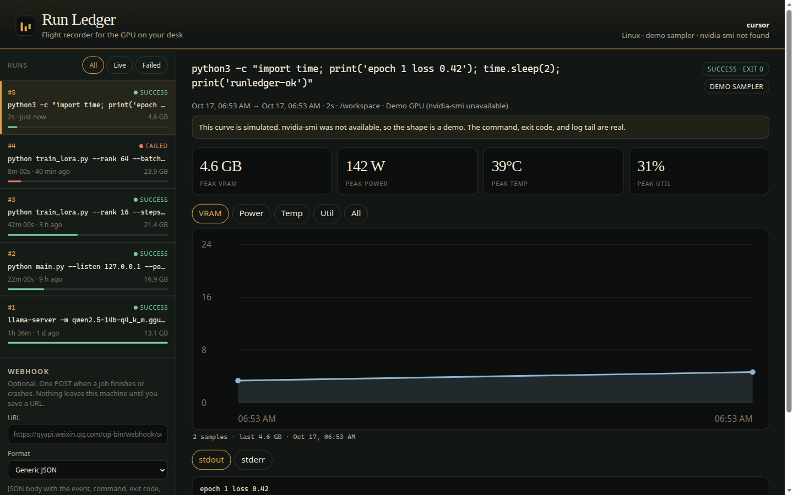
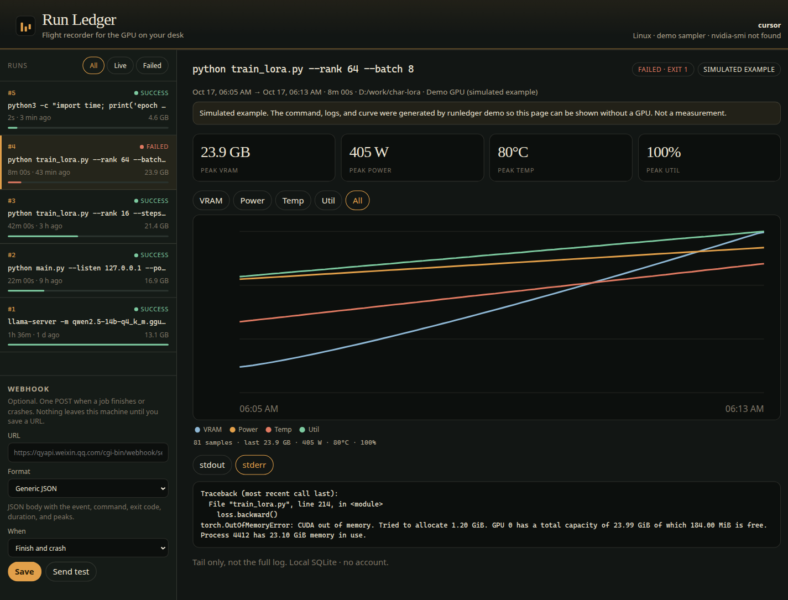
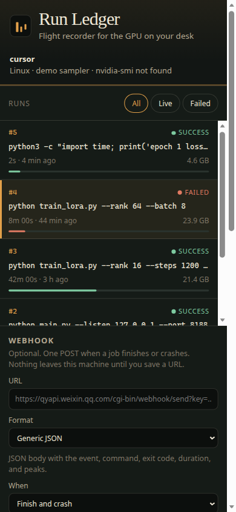
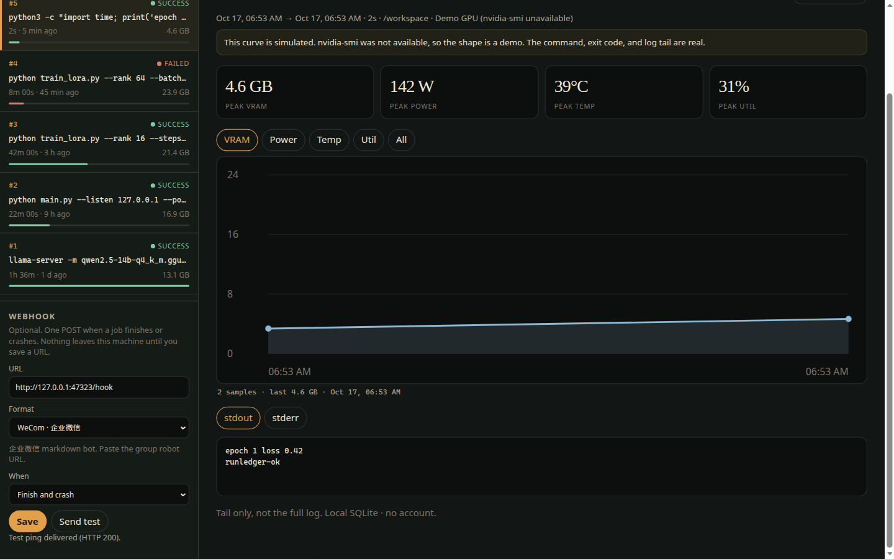

# Run Ledger

Run Ledger is a flight recorder for long GPU jobs on a single machine. Prefix the command you were already going to run. When you come back, the exit code, the last lines, and a GPU curve are still there. Optionally, one webhook fires when the job finishes or crashes.

It is for a solo developer with one GPU — the person running ComfyUI, a LoRA train, or a local LLM on a Windows box with an RTX 4090D — not for a cluster and not for an account.

```bash
runledger -- python train_lora.py --rank 16
runledger serve
```

## Install

Python 3.10 or newer. No runtime dependencies.

```bash
python -m pip install -e .
```

On Windows, if `python` is the `py` launcher:

```bat
py -m pip install -e .
```

Check it:

```bash
runledger -- python -c "print('runledger-ok')"
runledger serve
```

Open the URL it prints (default [http://127.0.0.1:8765](http://127.0.0.1:8765)). The run is at the top of the list. On Linux the interpreter is often `python3` rather than `python`; use whichever is on your PATH. A missing program is recorded as exit 127, not a traceback.

The ledger file is `~/.runledger/runs.sqlite`. Override it with `--db PATH` or `RUNLEDGER_DB`.

## Record a run

```bash
runledger -- python train_lora.py --rank 16 --steps 1200
```

Everything after `--` is the program and its arguments, not a shell string. Stdout and stderr still stream in the terminal. When the process exits, Run Ledger prints one summary line and exits with the child's code, so a script still fails when the train fails.

```text
runledger #12  success  exit 0  42m 00s  peak 21.4 GB  341 W  72°C
```

While the job runs, Run Ledger samples `nvidia-smi` every 3 seconds (VRAM, power, temperature, utilization). Change the gap with `--interval`.

```bash
runledger list
runledger show 12
```

Ctrl+C stops the child, stores the run as interrupted, and exits 130. Stdin is not forwarded.

Python is started with `PYTHONUNBUFFERED=1` when that variable is unset, so log lines show up before the process exits. Other programs may still buffer when stdout is a pipe; the tail is complete once they flush or exit.

## Dashboard

`runledger serve` is a page on this computer only. It does not load fonts, scripts, or images from the internet. Leave it open in a browser on the same machine.

```bash
runledger serve --port 8765
runledger serve --open
```

The list is newest first. Open a run for the peaks, the chart (VRAM, power, temperature, utilization, or all four), and the stdout / stderr tail. A job that is still running updates on the page. Closing the terminal does not delete the ledger.

Before any run exists, the page tells you the command to type:



After a wrap, the run is in the list. This screenshot is from a machine with no `nvidia-smi`. The banner says the curve is simulated. The exit code and the log tail are the real command.



`runledger demo` adds four labeled examples — a long train, a ComfyUI-like job, a local LLM, and an out-of-memory crash — and replaces earlier examples. It does not delete real wraps. The page badges them **Simulated example**. They are not measurements.



The same page stacks on a narrow window:



## Webhooks

Nothing is sent until you save a URL. Set it in the page, or from the terminal:

```bash
runledger notify "https://qyapi.weixin.qq.com/cgi-bin/webhook/send?key=YOUR_KEY" --format wecom
runledger notify --on both          # both | finish | crash
runledger notify --test
runledger notify --off
```

| Format | What is posted |
| --- | --- |
| `generic` | JSON with `event` (`run.finished` or `run.crashed`), command, exit code, duration, peaks |
| `wecom` | 企业微信 markdown bot body (`msgtype: markdown`) |
| `dingtalk` | 钉钉 markdown bot body. The title is `Run Ledger`, for bots that require a keyword |
| `feishu` | 飞书 interactive card (`msg_type: interactive`) |

A failed POST is stored on the run and shown on the page. It does not change the child's exit code.



Bot docs: [WeCom](https://developer.work.weixin.qq.com/document/path/91770), [DingTalk](https://open.dingtalk.com/document/robots/custom-robot-access), [Feishu](https://open.feishu.cn/document/client-docs/bot-v3/add-custom-bot).

## No GPU

If `nvidia-smi` is missing or returns nothing, the run is still recorded. The curve is a labeled demo (a 24 GB card warming up). The terminal says so once. The page says the curve is simulated and that the exit code and logs are real. `runledger demo` is how you fill the page for a recording without pretending those history rows were measured.

## Windows and Linux

The wrapper uses a process argument list, so the same `runledger -- program arg1 arg2` form works on both. Paths and the home directory follow the OS (`%USERPROFILE%\.runledger\runs.sqlite` on Windows, `~/.runledger/runs.sqlite` on Linux). The page defaults to `127.0.0.1`.

## Tests

```bash
python -m pip install -e ".[dev]"
python -m pytest
```

## Planning docs

This repo was planned with the [Devpost Learn Skill Pack](https://github.com/challengepost/learn-ai-basics) before the application code:

- `devpost/scope.md`
- `devpost/prd.md`
- `devpost/spec.md`

How that pack was used: `docs/skill-pack-usage.md`. A two-minute demo script is in `DEMO.md`. A draft hackathon write-up is in `SUBMISSION.md`.

License: MIT.
